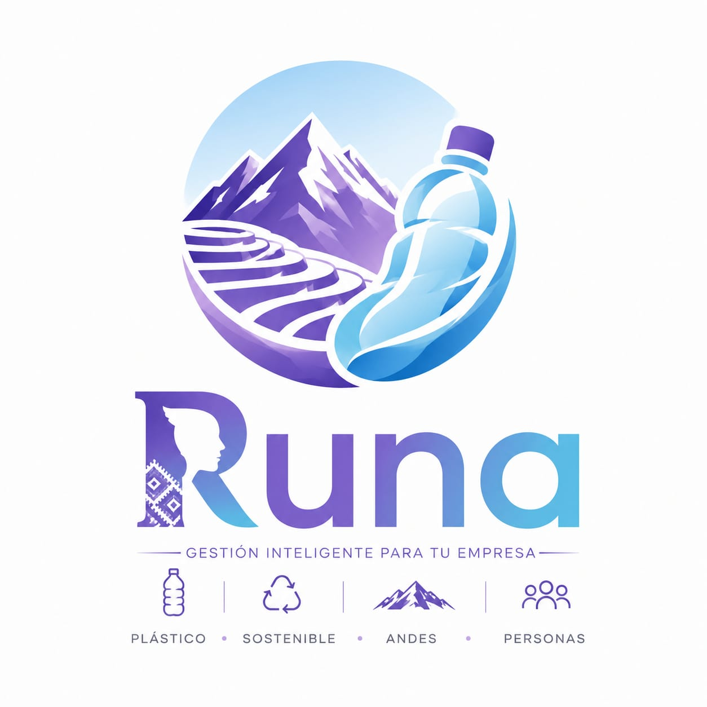

<div align="center">
  
  <h1>RUNA - Plataforma de Gestión e Inteligencia Comercial</h1>
  <p>Sistema integral para la manufactura, control de almacén y distribución de envases plásticos en mercados rurales.</p>

  <p>
    
    
    
    
    
  </p>
</div>

## Descripción del Proyecto

RUNA es una plataforma web empresarial orientada a optimizar la cadena de suministro en la distribución de envases plásticos y materiales de envasado en sectores rurales.

Integra un backend transaccional en Java para el control de inventario por lotes y auditoría contable, junto con un frontend interactivo en Angular diseñado bajo la estética Liquid Glassmorphism para una navegación ejecutiva y ágil.

---

## Pila Tecnológica

### Backend
- Lenguaje: Java 21 (LTS)
- Framework: Spring Boot 3.x
- Seguridad: Spring Security con autenticación Stateless mediante tokens JWT
- Acceso a Datos (ORM): Spring Data JPA / Hibernate
- Base de Datos: H2 Database (en memoria, configurada en compatibilidad con SQL Server)
- Mapeo y Utilidades: MapStruct, Lombok
- Generación de Documentos: Apache POI (Excel .xlsx) e iText (PDF)

### Frontend
- Framework: Angular 22 (Standalone Components, Zoneless Architecture)
- Lenguaje: TypeScript
- Diseño y Estilos: Tailwind CSS v3 con sistema de diseño Liquid Glass
- Cliente HTTP: HttpClient con reactividad RxJS

---

## Arquitectura del Software

El sistema implementa una arquitectura cliente-servidor desacoplada:

1. Frontend (SPA): Angular opera como una Single Page Application sin recargas de página, consumiendo servicios REST e intercambiando datos en formato JSON.
2. Backend (API RESTful en Capas):
   - Capa de Controladores (Controller): Exposición de endpoints REST, validación de DTOs y control de accesos basados en roles (RBAC).
   - Capa de Negocio (Service): Lógica transaccional, cálculo de importes, deducción automática de stock y emisión de reportes.
   - Capa de Acceso a Datos (Repository): Consultas a base de datos mediadas por Spring Data JPA y Hibernate.
   - Capa de Persistencia: Mapeo de entidades relacionales hacia el motor de base de datos.

---

## Estructura del Proyecto

```text
RUNA/
├── src/                                  # Backend (Spring Boot)
│   ├── main/
│   │   ├── java/com/runa/runa/
│   │   │   ├── config/                   # Configuración global y seeder inicial
│   │   │   ├── controller/               # Endpoints REST (Auth, Productos, Ventas, etc.)
│   │   │   ├── model/
│   │   │   │   ├── dto/                  # Data Transfer Objects (Requests y Responses)
│   │   │   │   ├── entity/               # Entidades JPA de base de datos
│   │   │   │   └── mapper/               # Mapeadores de datos con MapStruct
│   │   │   ├── repository/               # Repositorios Spring Data JPA
│   │   │   ├── security/                 # Filtros JWT y configuración de seguridad
│   │   │   ├── service/                  # Interfaces y lógica de negocio (impl/)
│   │   │   └── util/                     # Utilidades y contexto de seguridad
│   │   └── resources/
│   │       └── application.properties    # Configuración de base de datos, CORS y JWT
│   └── test/                             # Pruebas unitarias
│
├── frontend/                             # Frontend (Angular 22 + Tailwind CSS)
│   ├── public/                           # Recursos estáticos (logos e iconos)
│   ├── src/
│   │   ├── app/
│   │   │   ├── core/services/            # Servicios transversales (AuthService)
│   │   │   ├── pages/                    # Vistas y módulos de la aplicación
│   │   │   │   ├── dashboard/            # Panel de métricas y gráficos BI
│   │   │   │   ├── productos/            # Catálogo de envases plásticos
│   │   │   │   ├── categorias/           # Clasificación de líneas comerciales
│   │   │   │   ├── ventas/               # Registro y emisión de comprobantes
│   │   │   │   ├── inventario/           # Almacén, Kardex y control de stock mínimo
│   │   │   │   ├── pedidos/              # Despacho y seguimiento de órdenes
│   │   │   │   ├── clientes/             # Directorio de clientes y empresas
│   │   │   │   ├── proveedores/          # Gestión de insumos y materias primas
│   │   │   │   ├── reportes/             # Módulo de exportación en Excel y PDF
│   │   │   │   ├── usuarios/             # Control de cuentas y roles de operadores
│   │   │   │   └── login/                # Vista de inicio de sesión Liquid Glass
│   │   │   ├── shared/layout/            # Layout maestro (Sidebar y Topbar)
│   │   │   ├── app.config.ts             # Configuración Zoneless y providers HTTP
│   │   │   └── app.routes.ts             # Enrutamiento de la aplicación (SPA)
│   │   ├── index.html                    # Entrada HTML principal
│   │   └── styles.css                    # Directivas base de Tailwind CSS
│   ├── angular.json                      # Configuración de Angular CLI
│   └── package.json                      # Dependencias y scripts del frontend
│
├── mvnw / mvnw.cmd                       # Wrapper ejecutable de Maven
├── pom.xml                               # Dependencias del backend (Maven)
└── README.md                             # Documentación técnica del proyecto

Módulos del Sistema
- Dashboard Ejecutivo: Analítica de ventas semanales, productos de mayor rotación y alertas operativas.
- Inventario y Kardex: Control de existencias en tiempo real, ajuste de mermas, ingresos de mercadería y semáforo de stock bajo.
- Catálogo de Productos y Categorías: Registro, categorización y control de precios unitarios.
- Punto de Venta y Pedidos: Despacho de órdenes, anulación con reposición automática de stock y trazabilidad de comprobantes.
- Clientes y Proveedores: Directorio comercial segmentado por RUC/DNI y tipo de cliente (Mayorista/Minorista).
- Reportes y Auditoría: Exportación directa de balances contables en formatos Excel (.xlsx) y PDF.
- Seguridad y Usuarios: Gestión de roles de acceso (ADMIN, VENDEDOR) con sesiones cifradas mediante JWT.